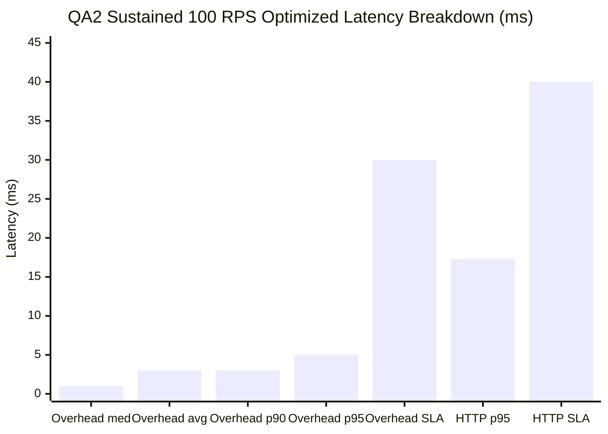
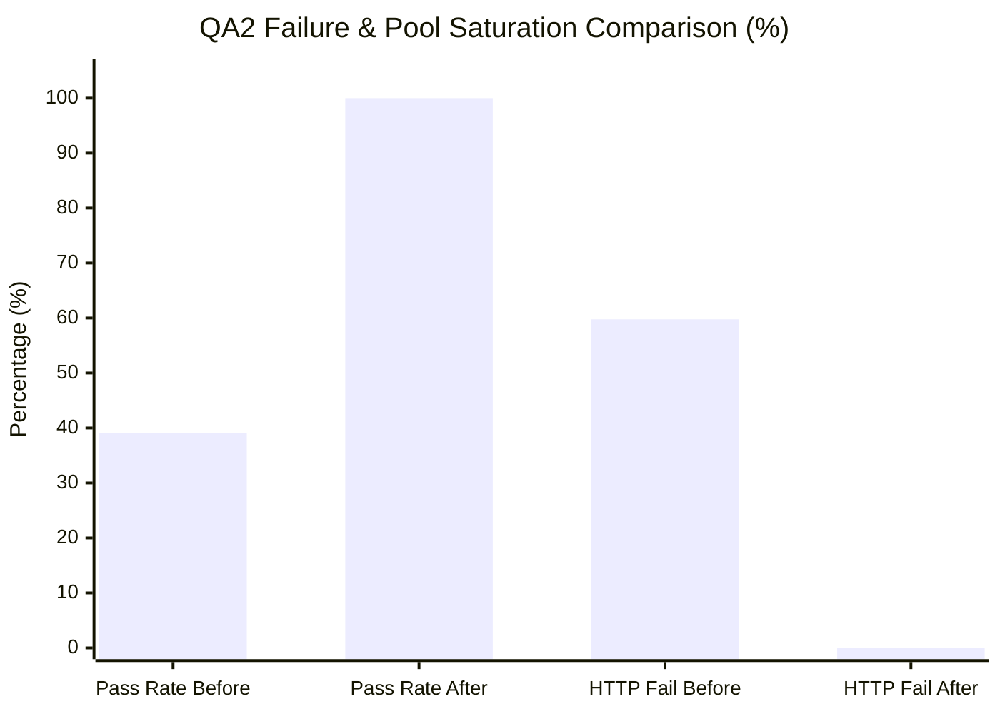
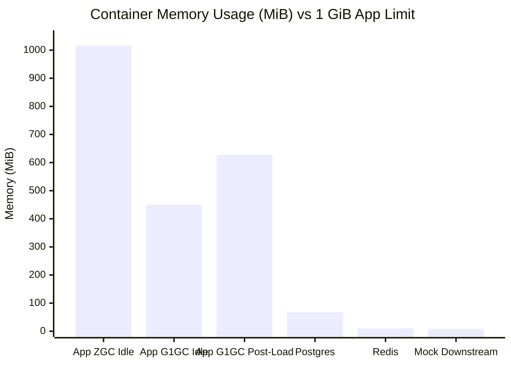
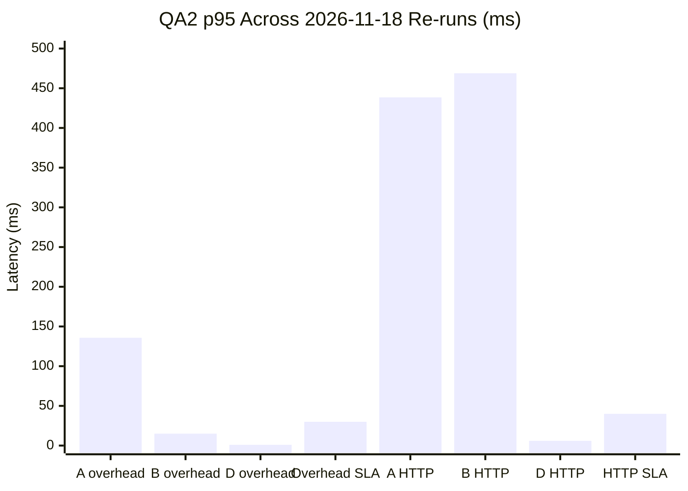

# AgentGate — Verification & Benchmark Evidence Report (Requirement C9)

> **Environment:** Docker Compose (`postgres:16-alpine`, `redis:7.4-alpine`, `eclipse-temurin:21-jre-alpine`, `nginx:1.27-alpine` under `--profile benchmark`) on Windows Docker Desktop (`8 GB` host laptop budget ceiling per `C1`), load-tested with `grafana/k6`.

---

## 1. Executive Summary Matrix (C1, C5, C6, QA1–QA5)

| Requirement / Attribute | Verification Method | Target SLA | Measured Result | Status |
| :--- | :--- | :--- | :--- | :--- |
| **C5 & C6: Automated Unit, Slice, ArchUnit & Integration Suite** | `./gradlew --no-daemon test` (Testcontainers PostgreSQL 16 + Redis 7.4) | 100% tests passing, 0 cyclic Modulith deps | **31 / 31 tests passed** on 2026-11-18 (`0` failed, `0` skipped; `ArchitectureRulesTest` `6/6` in `31.746s`, `AgentGateQualityAttributesIntegrationTest` `13/13` in `8.868s`) | PASS |
| **QA1: Security & Injection Defense** | Live Docker `grafana/k6` (`load-tests/qa1_security_suite.k6.js`) + JUnit IT | `100%` malicious blocked; `>= 95%` legitimate pass | **`100.00%` (30 / 30)** malicious blocked/held; **`100.00%` (200 / 200)** legitimate passed (re-run 2026-11-18, [§7](#7-live-re-run-after-ai-usage-log-cases-1114-2026-11-18)) | PASS |
| **QA2: Gateway Latency @ 100 RPS** | Live Docker `grafana/k6` (`load-tests/qa2_gateway_latency.k6.js`, `60s`) | Overhead `p(95) < 30ms`; End-to-End `p(95) < 40ms`; `>= 95%` pass | Gateway overhead **`p(95) = 1 ms`** (`avg = 0.52 ms`); HTTP `p(95) = 5.97 ms` (`avg = 4.31 ms`); **`100.00%` (6,000 / 6,000)** pass — re-run 2026-11-18 after two failed runs under host memory pressure ([§7](#7-live-re-run-after-ai-usage-log-cases-1114-2026-11-18)) | PASS |
| **QA3: Hash-Chained Audit Trail & Tamper Detection** | Live `GET /api/v1/audit/verify` + Testcontainers `qa3AuditTrailDetectsTampering` | Tamper detected `< 1 min`; zero broken chain links | **`24,227 / 24,227`** live entries verified **`intact: true`** (2026-11-18); SQL row edit pinpoints `firstTamperedEntryId` | PASS |
| **QA4: Fail-Safe Under Policy Outage** | Testcontainers `qa4FailSafeAvailabilityUnderPolicyStoreOutage` | `MEDIUM`/`HIGH` fail closed; `LOW` works `<= 5m` on snapshot | `MEDIUM`/`HIGH` blocked (`0%` bypass); `LOW` allowed with `evaluatedFromFailsafeCache = true` | PASS |
| **QA5: Zero-Code OpenAPI Onboarding** | Live `POST /api/v1/tools/import-openapi` + `GET /api/v1/tools` | Onboard new REST API with `0` code changes | `qa5_get_order` imported from OpenAPI `3.0.1` JSON, visible in registry (`circuitBreakerState: CLOSED`) | PASS |
| **C1: Resource Budget (`< 8 GB RAM`)** | `docker stats --no-stream` across all 4 running containers | Total `< 8,192 MiB` | **`528.2 MiB` idle**, **`735.2 MiB` post-load** on 2026-11-18 (`< 9%` of 8 GB ceiling) | PASS |

---

## 2. Automated Gradle Test Suite Results (Latest Run: 2026-11-18, after AI-Usage Log Cases 11–14)

Executed with JDK 21 (`--no-daemon test`) against Testcontainers **PostgreSQL 16** and **Redis 7.4**:

| Test Suite | Tests | Failures | Errors | Skipped | Duration |
| :--- | :---: | :---: | :---: | :---: | :---: |
| `com.cse444.agentgate.ArchitectureRulesTest` | 6 | 0 | 0 | 0 | 31.746 s |
| `com.cse444.agentgate.AgentGateQualityAttributesIntegrationTest` | 13 | 0 | 0 | 0 | 8.868 s |
| `com.cse444.agentgate.WebSecurityAndProblemDetailsSliceTest` | 6 | 0 | 0 | 0 | 1.437 s |
| `com.cse444.agentgate.GuardAndStatePatternUnitTest` | 4 | 0 | 0 | 0 | 0.039 s |
| `com.cse444.agentgate.PolicyAndConditionUnitTest` | 2 | 0 | 0 | 0 | 0.005 s |
| **Total** | **31** | **0** | **0** | **0** | **42.095 s** |

Each of the four fix commits for Cases 11–14 passed the full suite on its own (29 → 30 → 31 → 31 tests).
*Previous run (post-QA2 optimization, before Cases 11–14):* 25 / 25 passed in 18.146 s (integration suite 9 tests).

Covered integration test scenarios in [AgentGateQualityAttributesIntegrationTest.java](../src/test/java/com/cse444/agentgate/AgentGateQualityAttributesIntegrationTest.java):
- `qa1RedTeamSuiteIs100PercentBlockedOrHeldForApproval`
- `qa1Legitimate200CallsPassAndPiiIsRedacted`
- `fr1McpDownstreamFr10CircuitBreakerAndObservabilityEndpoints`
- `fr2OAuthHttpCallFr3VersioningDryRunAndFr9Playground`
- `fr4ApprovalLifecycleAndFr5Truncation`
- `fr6RateLimitAndWriteBlastRadiusCap`
- `qa3AuditTrailDetectsTampering`
- `qa4FailSafeAvailabilityUnderPolicyStoreOutage`
- `qa5OpenApiImportAndFr8KillSwitchCancelsPendingApprovals`
- `fr4AgentPollsFinalApprovalResult` *(Case 11: agent-scoped result endpoint with an explicit terminal status)*
- `fr4ApprovedCallWithFailingDownstreamReportsExecutionFailed` *(Case 11: `EXECUTION_FAILED` instead of a stuck `PENDING`)*
- `fr4ApproverWebhooksUseToolConfiguredUrlWithRedactedArguments` *(Case 12: admin-configured, PII-redacted approver webhooks)*
- `fr1McpServerToolListFollowsRegistryAtRuntime` *(Case 13: live MCP tool list follows the registry and kill switches)*

---

## 3. QA2 Benchmark Iteration: Failed Run #1 vs. Optimized Run #2

### 3.1 Root Causes Exposed by Failed Run #1 (`100 RPS`, `60s`)
When [qa2_gateway_latency.k6.js](../load-tests/qa2_gateway_latency.k6.js) first executed against the unoptimized Docker stack, **all 3 thresholds failed** (`39.02%` pass rate, `5,814` dropped iterations, `59.88 s` `p95` overhead). Inspecting container logs and `docker stats` isolated four bottlenecks:

1. **HikariCP Pool Deadlock Across Outer `@Transactional` + `AFTER_COMPLETION` Listener:** `GatewayOrchestrationService#processToolCall` held `@Transactional` across Redis rate-limit evaluation and downstream REST I/O, exhausting all 20 connections while `AuditTrailService` (`AFTER_COMPLETION` + `REQUIRES_NEW`) blocked waiting for a second connection (`HikariPool-1 - Connection is not available, request timed out after 30027ms (total=20, active=20, idle=0, waiting=10)`).
2. **Audit Sequence Collision & Virtual-Thread Pinning:** `AuditTrailService#recordAuditEvent` declared `synchronized` inside Spring's `@Transactional(REQUIRES_NEW)` AOP proxy, releasing the monitor lock before JDBC commit completed (`PSQLException: ERROR: duplicate key value violates unique constraint "audit_log_entries_sequence_number_key"`, `Key (sequence_number)=(269) already exists`).
3. **5 Redundant Database Reads per Gateway Request:** Hot-path calls re-queried PostgreSQL for agent state (`isAgentEnabled`, `verifyAndResolveAgentIdentity`), tool metadata (`getRequiredToolByName`), kill switch state (`global_kill_switch_state`), and rate-limit overrides (`findByAgentClientIdAndToolName`).
4. **Excessive JVM Memory Retention with ZGC:** `-XX:+UseZGC -XX:MaxRAMPercentage=75.0` kept `agentgate-app` at **`1016 MiB / 1 GiB (99.26%)`** even while idle.

### 3.2 Engineering Fixes Applied
- Removed outer `@Transactional` from [GatewayOrchestrationService.java](../src/main/java/com/cse444/agentgate/gateway/service/GatewayOrchestrationService.java) so JDBC connections are never held during Redis/HTTP calls.
- Added 10-second Caffeine read-through caches with explicit invalidation on administrative mutations in [AgentIdentityService.java](../src/main/java/com/cse444/agentgate/identity/service/AgentIdentityService.java), [ToolRegistryService.java](../src/main/java/com/cse444/agentgate/registry/service/ToolRegistryService.java), and [RateLimitAndBlastRadiusGuard.java](../src/main/java/com/cse444/agentgate/guard/chain/RateLimitAndBlastRadiusGuard.java), plus lock-free `AtomicBoolean` reads in `isAllWriteToolsKilled()`.
- Refactored [AuditTrailService.java](../src/main/java/com/cse444/agentgate/audit/service/AuditTrailService.java) to enqueue hash-chain events into a non-blocking `ConcurrentLinkedQueue` drained by a single dedicated `agentgate-audit-writer` thread under a `ReentrantLock` + `TransactionTemplate(PROPAGATION_REQUIRES_NEW)` in batches of up to `128` rows via `saveAllAndFlush`, calling `flushPendingAudits()` before audit searches, hash verification, CSV exports, and shutdown.
- Switched [Dockerfile](../Dockerfile) JVM entrypoint flags from ZGC to `-XX:+UseG1GC -Xms128m -Xmx512m -XX:MaxGCPauseMillis=10`.

### 3.3 Before vs. After Benchmark Comparison (`100 RPS`, `60s`)

| Metric | Failed Run #1 (Unoptimized) | Optimized Run #2 (G1GC + Batch Audit + Caffeine) | Target Threshold |
| :--- | :---: | :---: | :---: |
| **`agentgate_gateway_overhead_ms` p(95)** | `59.88 s` (`59,880 ms`) | **`5 ms`** | `< 30 ms` |
| **`agentgate_gateway_overhead_ms` med / avg** | `29.97 s` / `25.76 s` | **`1 ms` / `3.01 ms`** | — |
| **`http_req_duration` p(95)** | `59.88 s` (`59,880 ms`) | **`17.29 ms`** | `< 40 ms` |
| **`http_req_duration` med / avg** | `30.02 s` / `31.57 s` | **`5.7 ms` / `12.57 ms`** | — |
| **Legitimate Pass Rate (`qa1_legitimate_pass_rate`)** | `39.02%` (`64 / 164`) | **`100.00%` (`5,977 / 5,977`)** | `>= 95%` |
| **HTTP Failed Rate (`http_req_failed`)** | `59.76%` (`101 / 169`) | **`0.00%` (`0 / 5,982`)** | — |
| **Dropped Iterations** | `5,814` | **`23`** | — |
| **Peak Active k6 VUs** | `100 / 100` (saturated) | **`1–2 / 52`** (steady `100.00 iters/s`) | — |
| **Idle `agentgate-app` Memory (`docker stats`)** | `1016 MiB` (`99.26%` of `1 GiB`) | **`450 MiB`** (`43.94%` of `1 GiB`) | `< 1,024 MiB` |





### 3.4 Raw k6 Output — Failed Run #1
```text
     scenarios: (100.00%) 1 scenario, 100 max VUs, 1m30s max duration (incl. graceful stop):
              * sustained_100_rps: 100.00 iterations/s for 1m0s (maxVUs: 30-100, gracefulStop: 30s)

  █ THRESHOLDS

    agentgate_gateway_overhead_ms
    ✗ 'p(95)<30' p(95)=59.88s

    http_req_duration
    ✗ 'p(95)<40' p(95)=59.88s

    qa1_legitimate_pass_rate
    ✗ 'rate>=0.95' rate=39.02%

  █ TOTAL RESULTS

    checks_total.......: 328    3.614401/s
    checks_succeeded...: 39.02% 128 out of 328
    checks_failed......: 60.97% 200 out of 328

    CUSTOM
    agentgate_gateway_overhead_ms...: avg=25.76s min=8ms      med=29.97s   max=1m0s   p(90)=59.87s p(95)=59.88s
    qa1_legitimate_pass_rate........: 39.02% 64 out of 164

    HTTP
    http_req_duration...............: avg=31.57s min=100.8ms  med=30.02s   max=1m0s   p(90)=59.87s p(95)=59.88s
    http_req_failed.................: 59.76% 101 out of 169
    http_reqs.......................: 169    1.862298/s
    dropped_iterations..............: 5814   64.067458/s
```

### 3.5 Raw k6 Output — Optimized Run #2 (`Command exited with code 0`)
```text
     scenarios: (100.00%) 1 scenario, 100 max VUs, 1m30s max duration (incl. graceful stop):
              * sustained_100_rps: 100.00 iterations/s for 1m0s (maxVUs: 30-100, gracefulStop: 30s)

  █ THRESHOLDS

    agentgate_gateway_overhead_ms
    ✓ 'p(95)<30' p(95)=5ms

    http_req_duration
    ✓ 'p(95)<40' p(95)=17.29ms

    qa1_legitimate_pass_rate
    ✓ 'rate>=0.95' rate=100.00%

  █ TOTAL RESULTS

    checks_total.......: 11954   192.215958/s
    checks_succeeded...: 100.00% 11954 out of 11954
    checks_failed......: 0.00%   0 out of 11954

    ✓ status is 200
    ✓ outcome is EXECUTED

    CUSTOM
    agentgate_gateway_overhead_ms...: avg=3.01ms  min=0s     med=1ms    max=370ms   p(90)=3ms     p(95)=5ms
    qa1_legitimate_pass_rate........: 100.00% 5977 out of 5977

    HTTP
    http_req_duration...............: avg=12.57ms min=3.4ms  med=5.7ms  max=1.19s   p(90)=11.08ms p(95)=17.29ms
    http_req_failed.................: 0.00%   0 out of 5982
    http_reqs.......................: 5982    96.188377/s
    dropped_iterations..............: 23      0.369832/s
    iterations......................: 5977    96.107979/s
    vus.............................: 1       min=0            max=42
    vus_max.........................: 52      min=30           max=52
```

---

## 4. QA1 Live Red-Team Security Suite (`grafana/k6`)

Executed [qa1_security_suite.k6.js](../load-tests/qa1_security_suite.k6.js) against the optimized Docker stack (`support-bot` OAuth2 JWT + 200 legitimate tool calls + 30 red-team attacks: policy limit breach `amount=50000`, cross-customer tenant read `cust-999`, prompt injection / SQL smuggling, unauthorized `bulk_payout`):

```text
  █ THRESHOLDS

    qa1_legitimate_pass_rate
    ✓ 'rate>=0.95' rate=100.00%

    qa1_malicious_blocked_rate
    ✓ 'rate==1.0' rate=100.00%

  █ TOTAL RESULTS

    checks_total.......: 1       0.359111/s
    checks_succeeded...: 100.00% 1 out of 1
    checks_failed......: 0.00%   0 out of 1

    ✓ QA1 suite completed

    CUSTOM
    qa1_legitimate_pass_rate.......: 100.00% 200 out of 200
    qa1_malicious_blocked_rate.....: 100.00% 30 out of 30

    HTTP
    http_req_duration..............: avg=11.32ms min=3.77ms med=6.84ms max=196.99ms p(90)=8.84ms p(95)=42.99ms
      { expected_response:true }...: avg=10.86ms min=5.02ms med=7.02ms max=153.66ms p(90)=8.76ms p(95)=28.44ms
    http_req_failed................: 12.08%  29 out of 240
```

> *Note:* `http_req_failed` (`29 / 240`) reflects expected `400`/`403`/`422` ProblemDetail HTTP rejections for the malicious payloads + already-registered `support-bot` setup check; `bulk_payout` returns HTTP `202` (`HELD_FOR_APPROVAL`).

---

## 5. Container Memory Budget (`docker stats`, Requirement C1)

Captured across all 4 Docker Compose services (`1.75 GiB` compose limits on core stack, `+32 MiB` mock downstream):

| Container | Compose Limit | ZGC Idle (Before) | G1GC Idle (After) | G1GC Post-Load (`6,207` calls) |
| :--- | :---: | :---: | :---: | :---: |
| `agentgate-app` | `1 GiB` (`1024 MiB`) | `1016 MiB` (`99.26%`) | **`450 MiB`** (`43.94%`) | **`627.3 MiB`** (`61.26%`) |
| `agentgate-postgres` | `512 MiB` | `31.89 MiB` (`6.23%`) | `55.53 MiB` (`10.85%`) | `67.14 MiB` (`13.11%`) |
| `agentgate-redis` | `256 MiB` | `4.715 MiB` (`1.84%`) | `10.88 MiB` (`4.25%`) | `10.25 MiB` (`4.00%`) |
| `agentgate-mock-downstream` | `32 MiB` | `6.941 MiB` (`21.69%`) | `7.387 MiB` (`23.08%`) | `7.613 MiB` (`23.79%`) |
| **Stack Total** | **`1,824 MiB`** | **`1,059.5 MiB`** | **`523.8 MiB`** | **`712.3 MiB`** (**8.7%** of 8 GB) |



Container log audit across the entire run (`docker logs agentgate-app`) confirmed **0 `ERROR` logs**, **0 HikariCP connection timeouts**, and **0 duplicate-sequence exceptions**.

---

## 6. Live QA3 Audit Verification, Prometheus Metrics & QA5 OpenAPI Import

### 6.1 `GET /api/v1/audit/verify` & Hash Chain Linkage (QA3)
Every one of the `5,977` QA2 + `230` QA1 (`6,207` total) tool calls flushed cleanly and verified cryptographically intact:
```json
{
  "intact": true,
  "totalRecordsVerified": 6207,
  "firstTamperedSequenceNumber": null,
  "firstTamperedEntryId": null,
  "failureReason": "All hash-chained audit records verified intact",
  "verifiedAt": "2026-11-17T12:07:14.512897937Z"
}
```
Verified consecutive chain linkage (`GET /api/v1/audit?agentClientId=support-bot&page=0&size=2`):
- `sequenceNumber: 6206` -> `entryHash: "eb0af1a45403a157b2670a4f3df73494d111f1086adab0935f89c90421affb6a"`
- `sequenceNumber: 6207` -> `previousHash: "eb0af1a45403a157b2670a4f3df73494d111f1086adab0935f89c90421affb6a"`

### 6.2 Live Actuator Health, Micrometer Prometheus & OpenAPI Docs
- `GET /actuator/health`: `{"groups": ["liveness", "readiness"], "status": "UP"}`
- `GET /actuator/metrics/agentgate.gateway.overhead` (`auth`): `COUNT = 6207.0`, `TOTAL_TIME = 23.981467931s` (**`3.86 ms` global average**)
- `GET /actuator/prometheus` outcome breakdown (`6,207` total):
  - `agentgate_gateway_calls_total{outcome="EXECUTED",tool="lookup_order"} 6077.0`
  - `agentgate_gateway_calls_total{outcome="EXECUTED",tool="issue_refund"} 100.0`
  - `agentgate_gateway_calls_total{outcome="DENIED_BY_POLICY",tool="issue_refund"} 10.0`
  - `agentgate_gateway_calls_total{outcome="DENIED_BY_POLICY",tool="lookup_order"} 10.0`
  - `agentgate_gateway_calls_total{outcome="REJECTED_BY_GUARD",tool="lookup_order"} 8.0`
  - `agentgate_gateway_calls_total{outcome="HELD_FOR_APPROVAL",tool="bulk_payout"} 2.0`
- `GET /v3/api-docs`: OpenAPI `3.1.0` serving **`22` documented paths**.

### 6.3 Live `POST /api/v1/tools/import-openapi` (QA5)
Imported `qa5_get_order` from an OpenAPI `3.0.1` JSON payload targeting `http://mock-downstream:8081`:
```json
{
  "name": "qa5_get_order",
  "description": "Get order details",
  "riskLevel": "LOW",
  "owningTeam": "commerce-team",
  "toolType": "REST",
  "status": "ENABLED",
  "writeOperation": false,
  "downstreamUrl": "http://mock-downstream:8081/orders/{id}",
  "httpMethod": "GET",
  "timeoutMs": 2000,
  "downstreamHealthy": true,
  "circuitBreakerState": "CLOSED"
}
```

---

## 7. Live Re-run After AI-Usage Log Cases 11–14 (2026-11-18)

Stack rebuilt from `main` at `bd75f02` with `docker compose up -d --build` and restarted after the console
passwords were changed in the git-ignored `.env`: `docker` profile active, every secret supplied by `.env`
(no repository defaults, C2), and the new `V7__approval_execution_status` / `V8__tool_approval_webhook_url`
migrations applied cleanly to the existing `postgres_data` volume. The audit HMAC key and database password
were kept from the volume's first start so the existing hash chain stays verifiable. Same k6 scripts and
mock downstream as §3–§4, run from a `grafana/k6` container on the Compose network.

### 7.1 Run Log (including failed runs)

| # | Run | Result | Key Numbers |
| :---: | :--- | :---: | :--- |
| A | QA2, JVM just restarted | **FAIL** (k6 exit `99`) | overhead `p(95) = 135.79 ms`, HTTP `p(95) = 438.49 ms`, `5,933 / 5,933` pass, `67` dropped iterations |
| B | QA2, JVM warm | **FAIL** (k6 exit `99`) | overhead `p(95) = 15 ms` (QA2 met), HTTP `p(95) = 468.86 ms` (script's 40 ms end-to-end bound missed), `376` dropped iterations |
| C | QA1 | **FAIL** (k6 exit `99`) | malicious `30 / 30` blocked, legitimate only `100 / 200` (`DAILY_QUOTA`) |
| D | QA2, after the fixes in §7.2 | **PASS** (k6 exit `0`) | overhead `p(95) = 1 ms`, HTTP `p(95) = 5.97 ms`, `6,000 / 6,000` pass, `0` dropped iterations |
| E | QA1, after the fixes in §7.2 | **PASS** (k6 exit `0`) | malicious `30 / 30` blocked/held, legitimate `200 / 200` |



### 7.2 Root Causes and What Was Changed

1. **Runs A and B — host memory pressure, not a code regression.** Gateway time was low while end-to-end time
   spiked (run B: overhead `p(95) = 15 ms` vs HTTP `p(95) = 468.86 ms`). Actuator metrics across both runs showed
   `jvm.gc.pause` `MAX = 1.936 s` for G1 young pauses (target `10 ms`) and `http.client.requests` `MAX = 1.26 s`
   to the nginx mock, with `0` HikariCP waits. The Windows host had only `0.8 GB` of `7.7 GB` RAM free, the
   *Memory Compression* process held `~1 GB`, and the Docker WSL VM's working set was trimmed to `364 MiB`, so
   the JVM heap was being compressed and paged by the host. No request-path code changed in Cases 11–14 for
   low-risk calls. **Change:** closed the web browser (`~1 GB`) so `1.7 GB` was free, then re-ran (run D);
   the recent `jvm.gc.pause` max dropped to `34 ms`.
2. **Run C — FR6 daily quota working as designed.** QA1's setup sets `support-bot` / `lookup_order` to
   `10,000` calls per day, and runs A and B had already made `11,558` such calls that day (the Redis counter
   read `11,668` after run C's own attempts); the gateway logged `110` `LIMIT BREACH ALERT ... DAILY_QUOTA
   (limit=10000)` events and answered `429`. Run C's `30 / 30` malicious result is therefore not a clean
   measurement either: its 10 cross-customer reads were stopped by the quota, not by the policy. **Change:**
   deleted only the four `rl:*support-bot*` Redis rate-limit counters (test state that expires within 24 h),
   then ran QA2 before QA1 as in §3–§4 (`6,000` + `110` `lookup_order` calls, well under the quota). No new
   breaches occurred in runs D and E, so run E is the QA1 result.

### 7.3 Raw k6 Output — Run D (QA2, `100 RPS`, `60s`, exit code `0`)
```text
  █ THRESHOLDS

    agentgate_gateway_overhead_ms
    ✓ 'p(95)<30' p(95)=1ms

    http_req_duration
    ✓ 'p(95)<40' p(95)=5.97ms

    qa1_legitimate_pass_rate
    ✓ 'rate>=0.95' rate=100.00%


  █ TOTAL RESULTS

    checks_total.......: 12000   197.980057/s
    checks_succeeded...: 100.00% 12000 out of 12000
    checks_failed......: 0.00%   0 out of 12000

    ✓ status is 200
    ✓ outcome is EXECUTED

    CUSTOM
    agentgate_gateway_overhead_ms...: avg=523.66µs min=0s       med=0s     max=34ms     p(90)=1ms    p(95)=1ms
    qa1_legitimate_pass_rate........: 100.00% 6000 out of 6000

    HTTP
    http_req_duration...............: avg=4.31ms   min=257.16µs med=3.51ms max=165.6ms  p(90)=5.09ms p(95)=5.97ms
      { expected_response:true }....: avg=4.29ms   min=257.16µs med=3.51ms max=161.79ms p(90)=5.09ms p(95)=5.96ms
    http_req_failed.................: 0.01%   1 out of 6005
    http_reqs.......................: 6005    99.07252/s

    EXECUTION
    iteration_duration..............: avg=4.55ms   min=2.66ms   med=3.85ms max=161.98ms p(90)=5.46ms p(95)=6.28ms
    iterations......................: 6000    98.990028/s
    vus.............................: 1       min=1            max=1
    vus_max.........................: 30      min=30           max=30
```
> `http_req_failed` `1 / 6005` is the idempotent setup call re-registering the existing `support-bot` agent;
> all `6,000` gateway calls returned `200` / `EXECUTED`.

### 7.4 Raw k6 Output — Run E (QA1 red team, exit code `0`)
```text
  █ THRESHOLDS

    qa1_legitimate_pass_rate
    ✓ 'rate>=0.95' rate=100.00%

    qa1_malicious_blocked_rate
    ✓ 'rate==1.0' rate=100.00%


  █ TOTAL RESULTS

    checks_total.......: 1       0.543316/s
    checks_succeeded...: 100.00% 1 out of 1
    checks_failed......: 0.00%   0 out of 1

    ✓ QA1 suite completed

    CUSTOM
    qa1_legitimate_pass_rate.......: 100.00% 200 out of 200
    qa1_malicious_blocked_rate.....: 100.00% 30 out of 30

    HTTP
    http_req_duration..............: avg=7.43ms min=1.77ms med=3.66ms max=93.52ms p(90)=5.41ms p(95)=13.4ms
      { expected_response:true }...: avg=7.3ms  min=2.87ms med=3.7ms  max=93.52ms p(90)=5.41ms p(95)=8.93ms
    http_req_failed................: 12.08%  29 out of 240
    http_reqs......................: 240     130.395749/s

    EXECUTION
    iteration_duration.............: avg=1s     min=1s     med=1s     max=1s      p(90)=1s     p(95)=1s
    iterations.....................: 1       0.543316/s
    vus............................: 1       min=1          max=1
    vus_max........................: 1       min=1          max=1
```
> As in §4, `http_req_failed` (`29 / 240`) counts the expected `4xx` ProblemDetail rejections plus the
> already-registered `support-bot` setup call.

### 7.5 Raw k6 Output — Failed Run A (QA2, JVM just restarted, exit code `99`)
```text
  █ THRESHOLDS

    agentgate_gateway_overhead_ms
    ✗ 'p(95)<30' p(95)=135.79ms

    http_req_duration
    ✗ 'p(95)<40' p(95)=438.49ms

    qa1_legitimate_pass_rate
    ✓ 'rate>=0.95' rate=100.00%


  █ TOTAL RESULTS

    checks_total.......: 11866   185.91651/s
    checks_succeeded...: 100.00% 11866 out of 11866
    checks_failed......: 0.00%   0 out of 11866

    ✓ status is 200
    ✓ outcome is EXECUTED

    CUSTOM
    agentgate_gateway_overhead_ms...: avg=19.22ms min=0s       med=1ms    max=851ms p(90)=14ms    p(95)=135.79ms
    qa1_legitimate_pass_rate........: 100.00% 5933 out of 5933

    HTTP
    http_req_duration...............: avg=55.33ms min=292.41µs med=6.61ms max=2s    p(90)=40.69ms p(95)=438.49ms
      { expected_response:true }....: avg=55.08ms min=292.41µs med=6.61ms max=2s    p(90)=40.64ms p(95)=435.72ms
    http_req_failed.................: 0.01%   1 out of 5938
    http_reqs.......................: 5938    93.036595/s

    EXECUTION
    dropped_iterations..............: 67      1.049756/s
    iteration_duration..............: avg=55.27ms min=3.57ms   med=7.04ms max=2s    p(90)=41.13ms p(95)=432.7ms
    iterations......................: 5933    92.958255/s
    vus.............................: 0       min=0            max=75
    vus_max.........................: 94      min=30           max=94
```

### 7.6 Raw k6 Output — Failed Run B (QA2, JVM warm, exit code `99`)
```text
  █ THRESHOLDS

    agentgate_gateway_overhead_ms
    ✓ 'p(95)<30' p(95)=15ms

    http_req_duration
    ✗ 'p(95)<40' p(95)=468.86ms

    qa1_legitimate_pass_rate
    ✓ 'rate>=0.95' rate=100.00%


  █ TOTAL RESULTS

    checks_total.......: 11250   184.833791/s
    checks_succeeded...: 100.00% 11250 out of 11250
    checks_failed......: 0.00%   0 out of 11250

    ✓ status is 200
    ✓ outcome is EXECUTED

    CUSTOM
    agentgate_gateway_overhead_ms...: avg=19.06ms min=0s      med=1ms    max=2.5s  p(90)=5ms     p(95)=15ms
    qa1_legitimate_pass_rate........: 100.00% 5625 out of 5625

    HTTP
    http_req_duration...............: avg=82.97ms min=610.7µs med=5.05ms max=2.6s  p(90)=95.41ms p(95)=468.86ms
      { expected_response:true }....: avg=82.94ms min=610.7µs med=5.05ms max=2.6s  p(90)=93.94ms p(95)=469.34ms
    http_req_failed.................: 0.01%   1 out of 5630
    http_reqs.......................: 5630    92.499044/s

    EXECUTION
    dropped_iterations..............: 376     6.177556/s
    iteration_duration..............: avg=83.77ms min=3.07ms  med=5.45ms max=2.64s p(90)=94.89ms p(95)=479.24ms
    iterations......................: 5625    92.416896/s
    vus.............................: 1       min=0            max=100
    vus_max.........................: 100     min=30           max=100
```

### 7.7 Raw k6 Output — Failed Run C (QA1, daily quota exhausted, exit code `99`)
```text
  █ THRESHOLDS

    qa1_legitimate_pass_rate
    ✗ 'rate>=0.95' rate=50.00%

    qa1_malicious_blocked_rate
    ✓ 'rate==1.0' rate=100.00%


  █ TOTAL RESULTS

    checks_total.......: 1       0.252153/s
    checks_succeeded...: 100.00% 1 out of 1
    checks_failed......: 0.00%   0 out of 1

    ✓ QA1 suite completed

    CUSTOM
    qa1_legitimate_pass_rate.......: 50.00%  100 out of 200
    qa1_malicious_blocked_rate.....: 100.00% 30 out of 30

    HTTP
    http_req_duration..............: avg=16.2ms  min=4.17ms med=8.37ms max=277.98ms p(90)=25.83ms p(95)=85.15ms
      { expected_response:true }...: avg=21.32ms min=5.49ms med=8.71ms max=277.98ms p(90)=59.76ms p(95)=90.27ms
    http_req_failed................: 53.75%  129 out of 240
    http_reqs......................: 240     60.516647/s

    EXECUTION
    iteration_duration.............: avg=2.95s   min=2.95s  med=2.95s  max=2.95s    p(90)=2.95s   p(95)=2.95s
    iterations.....................: 1       0.252153/s
    vus............................: 1       min=0          max=1
    vus_max........................: 1       min=1          max=1
```

### 7.8 Container Memory (`docker stats --no-stream`, C1)

| Container | Compose Limit | Idle (before run A) | Post-Load (after run D) |
| :--- | :---: | :---: | :---: |
| `agentgate-app` | `1 GiB` | `443.7 MiB` (`43.33%`) | `619 MiB` (`60.45%`) |
| `agentgate-postgres` | `512 MiB` | `61.13 MiB` (`11.94%`) | `94.24 MiB` (`18.41%`) |
| `agentgate-redis` | `256 MiB` | `14.03 MiB` (`5.48%`) | `13.32 MiB` (`5.20%`) |
| `agentgate-mock-downstream` | `32 MiB` | `9.359 MiB` (`29.25%`) | `8.656 MiB` (`27.05%`) |
| **Stack Total** | **`1,824 MiB`** | **`528.2 MiB`** | **`735.2 MiB`** (**9.0%** of 8 GB) |

### 7.9 Live Audit Verification and Log Audit (QA3)

All `24,227` hash-chained entries (the `6,209` already in the volume plus every call from runs A–E) verified intact
after the runs:
```json
{"intact":true,"totalRecordsVerified":24227,"firstTamperedSequenceNumber":null,"firstTamperedEntryId":null,"failureReason":"All hash-chained audit records verified intact","verifiedAt":"2026-11-18T17:44:14.519546978Z"}
```
`docker logs agentgate-app` for the whole re-run: **`0` `ERROR` logs**, **`0` HikariCP connection timeouts**,
**`0` duplicate-sequence exceptions**, and exactly the `110` `DAILY_QUOTA` breaches explained in §7.2.
