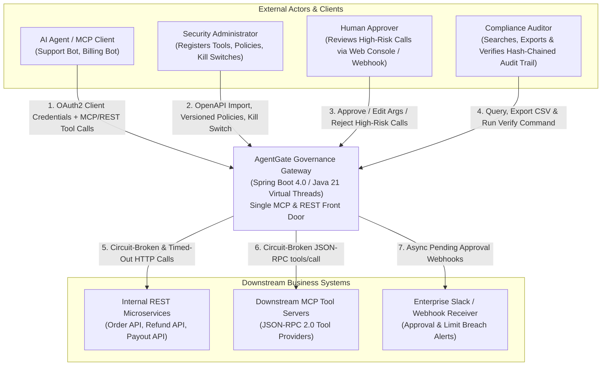
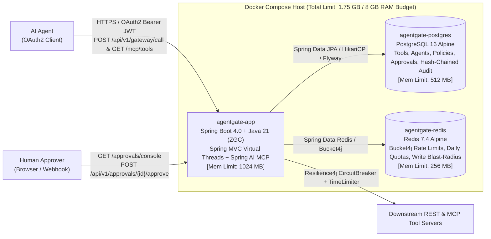
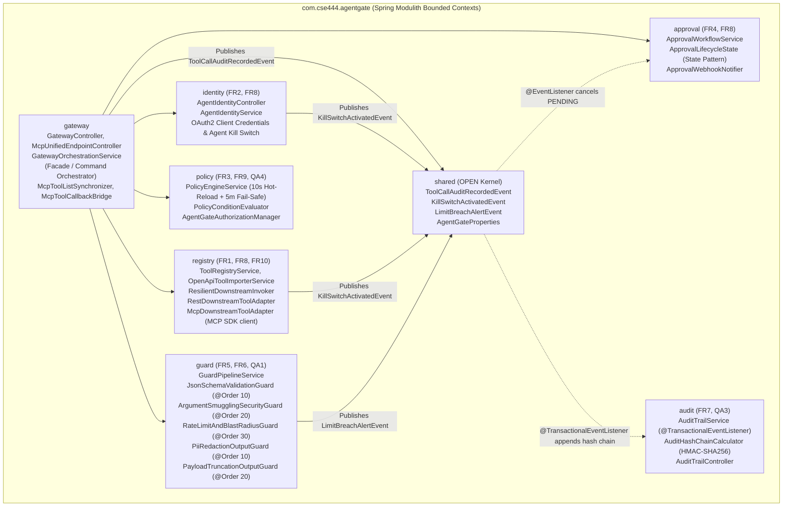

# AgentGate — C4 Architecture Diagrams (Context, Container, Component)

## 1. C4 Level 1 — System Context Diagram

---

## 2. C4 Level 2 — Container Diagram (< 8 GB RAM Docker Compose Stack)

---

## 3. C4 Level 3 — Component / Spring Modulith Diagram

